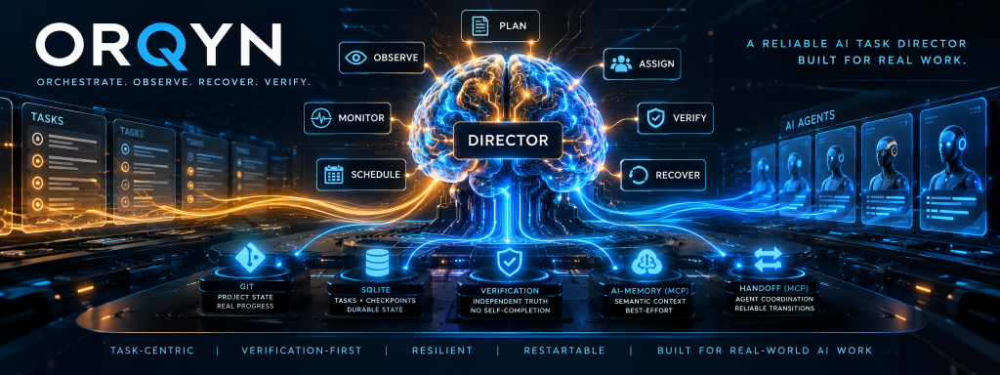
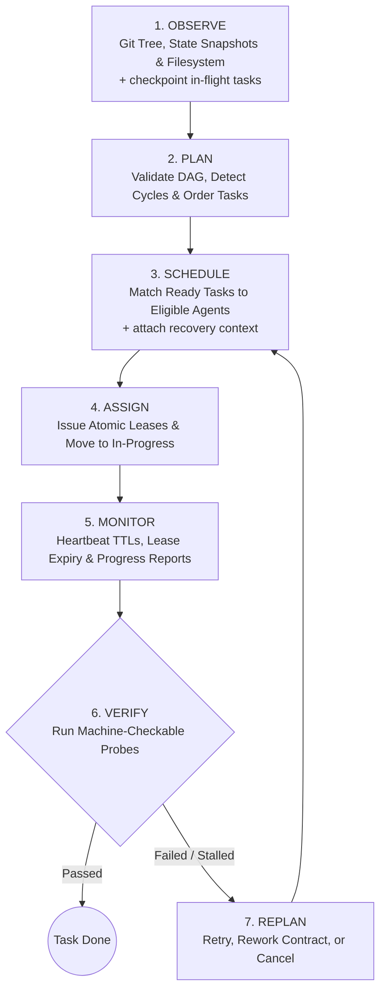

<div align="center">



# 🧠 Orqyn

[](https://www.rust-lang.org/)
[](LICENSE)
[](docs/PHASE0-FORENSICS.md)
[](tests/)
[](docs/)

**A vendor-independent orchestration brain for multi-agent software engineering.**

[Description](#project-description) • [Why Orqyn?](#why-orqyn) • [Core Invariants](#core-invariants) • [Control Loop](#the-control-loop) • [Architecture](#architecture) • [Crates](#crate-hierarchy) • [Quickstart](#quickstart) • [Roadmap](#roadmap) • [Documentation](#documentation)

</div>

---

## Project Description

**Orqyn** is an autonomous, vendor-agnostic orchestration brain built in pure Rust for coordinating multi-agent software engineering teams. 

Modern coding agents (such as Claude Code, OpenAI Codex, DeepSeek, Cursor, Goose, Devin, OpenCode, and Aider) are exceptional at local syntax generation, refactoring, and code comprehension. Concurrently, specialized tool servers like [handoff-mcp](https://github.com/alphaelements/handoff-mcp) and [ai-memory](https://github.com/akitaonrails/ai-memory) provide persistence backends for session logs and vector/FTS knowledge graphs.

However, existing multi-agent systems suffer from a critical architectural void: **no layer acts as an objective, supervisory brain.** 

Orqyn fills this gap. Sitting **above** the coding agents and **beside** memory/task substrates, Orqyn acts as an authoritative control engine that:
1. **Decomposes and validates objectives** into mathematically verified Directed Acyclic Graphs (DAGs).
2. **Dispatches work via time-limited, heartbeat-monitored leases** using an intelligent multi-agent matchmaker.
3. **Reclaims stranded work automatically** when an agent crashes, hangs, or disappears.
4. **Independently verifies completed work** using isolated, machine-checked test probes—completely eliminating hallucinated "I am done" declarations.
5. **Maintains append-only, transactional audit logs** backed by SQLite with optimistic concurrency versioning.
6. **Briefs replacement agents** with complete continuation packages containing project state, git diffs, prior verdicts, and dependency contracts.

```
                    ┌─────────────────────────────────────────────┐
                    │                   ORQYN                     │
                    │   Orchestration Brain & Control Engine      │
                    │   (Plan, Schedule, Assign, Verify, Recover) │
                    └───────────────┬────────────────────┬────────┘
                                    │                    │
                   MCP (stdio JSON) │                    │ MCP (stdio JSON)
                                    ▼                    ▼
               ┌───────────────────────┐      ┌──────────────────────────┐
               │      handoff-mcp      │      │        ai-memory         │
               │  Task/Session/Agent   │      │   Wiki + Long-Term Mem   │
               │  Substrate (.handoff) │      │   (SQLite + Markdown)    │
               └───────────┬───────────┘      └────────────┬─────────────┘
                           │                               │
                           └───────────────┬───────────────┘
                                           │ (Orqyn Drives Agents)
                                           ▼
                     ┌───────────────────────────────────────────┐
                     │              AGENT HARNESSES              │
                     │  Claude Code, Codex, DeepSeek, Cursor,    │
                     │  Goose, Devin, OpenCode, Aider, etc.      │
                     └─────────────────────┬─────────────────────┘
                                           │
                                           ▼
                                 GIT WORKING TREE / REPO
```

Orqyn communicates with all external substrates **exclusively over Model Context Protocol (MCP)** using line-delimited JSON-RPC 2.0 over `stdio`. It never links substrate source code, never imports substrate internal data structures, and enforces strict boundary isolation through automated CI tests.

---

## Why Orqyn?

### The 6 Failure Modes of Autonomous Multi-Agent Coding

| Failure Mode | Traditional Multi-Agent Setups | The Orqyn Solution |
|---|---|---|
| **1. Self-Reported Completion** | Agents mark tasks "Done" after generating code, even when unit tests fail or code does not compile. | **Objective Machine Probes**: `TaskStatus::Done` is unreachable by agent reports. Orqyn executes commands and test suites independently, reading exit codes directly. |
| **2. The Vanished Agent** | If an agent process crashes or loses its network connection, its assigned task is orphaned indefinitely. | **Heartbeat Lease Reclamation**: Assignments carry time-to-live leases. A silent agent loses its lease; the session is recorded as `vanished`, and the task returns to `todo`. |
| **3. Dependency Deadlocks** | Unchecked task lists result in circular blockers, missing prerequisite artifacts, or race conditions between parallel agents. | **Acyclic Graph (DAG) Engine**: Plans are validated for cycles, external references, and self-dependencies using Kahn's topological sort before atomic activation. |
| **4. Substrate Lock-in** | Orchestrators compile directly against specific memory or task libraries, creating rigid vendor lock-in. | **Zero Substrate Coupling**: Everything communicates across standard MCP JSON-RPC boundaries. Boundary tests fail the build if internal structs are imported. |
| **5. Destructive State Overwrites** | Task updates, decisions, and replans overwrite previous records in place, destroying historical audit trails. | **Append-Only SQLite History**: Plans supersede rather than delete. Decisions, verifications, and assignment histories accumulate durably with optimistic locking. |
| **6. Amnesiac Replacements** | A replacement agent restarts a task from a blank prompt — re-reading the tree, re-deriving intent, and redoing work the previous agent already finished. | **Evidence-Backed Recovery Context**: OBSERVE checkpoints in-flight work from git evidence on every real change, and `RecoveryBuilder` hands a replacement the continuation package: task contract, checkpoint lineage, prior verdicts, and exactly what to do next. |

---

## Core Invariants

Orqyn is architected around strict foundational invariants enforced in Rust's type system and database schemas:

### 1. Task Identity is Decoupled from Agent Identity
A task represents a unit of work that outlives any single agent assigned to it.
- `TaskId` and `AgentId` are sealed, distinct newtypes that cannot be coerced into one another.
- `Task` structs contain **no agent field**.
- Assignments are tracked via first-class `AgentAssignment` records. When an agent disconnects, crashes, or releases work, a new assignment record is created while the task’s identity and version history remain immutable.

### 2. Zero Self-Reported Completion (Machine-Checked Verification)
`TaskStatus::Done` is **unreachable** through an agent's self-report.
- An agent completing its work moves a task to `VerificationPending`, never `Done`.
- Only Orqyn's independent `VERIFY` engine can mark a task complete by executing machine-checkable probes (e.g. exit codes, test suites, deterministic diff checks) via its isolated `ExecutionProvider`.
- If an agent claims work is done but checks fail, the task transitions to `Failed` and triggers remediation in `REPLAN`.

### 3. Deterministic & Acyclic Graph Planning
Task dependencies form a strict Directed Acyclic Graph (DAG).
- The planner validates and rejects self-dependencies, references to external tasks, and cyclical dependency graphs.
- Tasks are ordered deterministically using Kahn’s topological sort with caller-order tie-breaking.
- Plan creation, task decomposition, and activation execute in a single atomic database transaction.

### 4. Lease-Based Scheduling with Automatic Stale Reclamation
Agent assignments operate under time-limited leases backed by active heartbeats.
- The `MONITOR` step inspects active leases against heartbeat timestamps.
- If an agent becomes silent past the lease TTL, Orqyn automatically expires the lease, marks the session as `vanished`, records the disconnect, and returns the task to `todo` for immediate reassignment.

### 5. Durable, Append-Only Storage & Optimistic Locking
State transitions and decisions are never overwritten destructively.
- Backed by an embedded SQLite engine with strict foreign keys and partial unique indexes (e.g., enforcing at most one active plan per project, at most one active assignment per task, and at most one current checkpoint per task).
- Uses optimistic concurrency control (`state_version` lineage): concurrent stale writes fail fast and return structured conflict errors.
- Verifications, superseded plans, and rejected decisions accumulate as durable audit logs.

### 6. The Substrate Boundary is a Test, Not a Convention
Orqyn enforces architectural boundaries through automated regression tests:
- `crates/director-adapters/tests/boundary.rs` scans the entire workspace and fails the build if any crate outside `director-adapters` references substrate identifiers or crate dependencies.

### 7. Resumption is Grounded in Evidence, Not Narrative
A replacement agent picks up in-flight work from a checkpoint, and that checkpoint is written only by the one step that looks at the repository.
- Checkpoints are derived inside OBSERVE — the only step holding git state — and only when the round recorded a *real* change: a moved `HEAD`, a moved branch, or a changed working tree.
- Quiet rounds write nothing. A checkpoint that merely restates the previous one is detected (`restates_current`) and skipped, so the per-task recovery lineage carries one entry per genuine advance instead of noise.
- Checkpoint ids advance with the lineage rather than with a process-local counter, so a restarted Orqyn cannot re-mint an id the lineage already used and abort its first observation round on a primary-key collision.
- SQLite is authoritative; publishing a checkpoint to semantic memory that fails or times out is reported as a gap, not an error.

### 8. Two Agents Never Hold the Same Ground
Every task declares what it may touch, and no two tasks with overlapping scope are in flight at once.
- Each task's `scope_paths` are normalized before comparison: separators unified, `.` and `..` resolved, empty segments dropped, `\` accepted. `src\auth`, `./src/auth/`, and `src/x/../auth` are one scope.
- Two scopes overlap when one is a **path prefix** of the other, so a parent directory covers what is inside it and `/` — the repository root — covers the whole tree.
- **An empty scope means undeclared, not empty.** A task that says nothing about what it may touch is treated as unrestricted, because reading an empty list as "safe beside anything" would make the default task silently unsafe. The cost is honest: declaring disjoint scopes is what buys concurrency.
- SCHEDULE refuses a pairing whose ground another task in the same round already took; ASSIGN refuses the handoff against any task already `in_progress`, re-read from the store on every call so a task that started after planning is caught.
- A refusal is structured and names both the task in the way and the paths in dispute — `AssignError::ScopeConflict`, or `UnassignedReason::ScopeConflict` for contention within a round. Nothing is written, and the task stays `todo`.
- Comparison is case-sensitive on every platform, so the same plan yields the same assignments on Linux, macOS, and Windows. See [`docs/PHASE13-CONFLICT-DETECTION.md`](docs/PHASE13-CONFLICT-DETECTION.md) for the full semantics and the known limitation this creates on a case-insensitive filesystem.

---

## The Control Loop

Orqyn operates a continuous 7-step closed-loop lifecycle, with a checkpoint writer running inside OBSERVE and a recovery context assembled on demand to brief replacements:



### Step Breakdown

| Step | Function | Responsibility |
|---|---|---|
| **OBSERVE** | `observe::observe` | Scans the git working tree via `git2`, produces `ProjectStateSnapshot`, detects tree changes/renames/deletions, and syncs normalized state into Orqyn's store. |
| **CHECKPOINT** | `checkpoint::checkpoint_round` | Runs inside the observation round. For every `in_progress` task whose round recorded a real change (moved `HEAD`, moved branch, or a changed working tree), it derives and persists a `Checkpoint` — and skips quiet rounds so a checkpoint that merely restates the previous one never pollutes the recovery lineage. |
| **PLAN** | `plan::plan` | Validates task specs against DAG rules (no cycles, no missing dependencies), computes topological sequence, and atomically activates the plan. |
| **SCHEDULE** | `schedule::schedule` | Pairs unassigned `ready_tasks` with available agents using a 4-tier policy: eligibility, fresh-eyes (prioritizing new agents), specialist-first (conserving generalists), and deterministic tie-breaking. When it hands a task to a replacement agent, it attaches the recovery context built by `recovery::RecoveryBuilder`. |
| **ASSIGN** | `assign::assign` | Acquires a claim-once lease for an agent, transitions task status to `in_progress`, and records the assignment transactionally. |
| **MONITOR** | `monitor::monitor` | Checks heartbeat ages against TTL windows. Reclaims expired leases from vanished agents, handles progress reports, and moves finished work to `verification_pending`. |
| **VERIFY** | `verify::verify` | Resolves machine-checkable criteria into probes (`Probe::Command`), executes them via `ExecutionProvider`, reads raw exit codes, and writes append-only `Verification` records. |
| **REPLAN** | `replan::replan` | Evaluates failed or stranded tasks and applies caller-specified remediations (`Retry`, `Rework`, or `Cancel`) while reporting any dependent tasks left stranded. |
| **RECOVERY** | `recovery::RecoveryBuilder` | Assembles a complete continuation package (contracts, version history, previous verdicts, git checkpoint) in one place, so a replacement agent — or a driver briefing one — asks one question and gets one answer. |

---

## Architecture

```
                               ┌─────────────────────────────────────────┐
                               │             ORQYN CORE                  │
                               │                                         │
 ┌─────────────────────────┐   │   ┌─────────────────────────────────┐   │
 │   director-app          │───┼──>│  Control Loop Engine            │   │
 │   (Loop orchestration)  │   │   │  • observe   • schedule         │   │
 └─────────────────────────┘   │   │  • plan      • monitor          │   │
                               │   │  • assign    • verify / replan  │   │
 ┌─────────────────────────┐   │   └────────────────┬────────────────┘   │
 │   director-store        │───┼────────────────────┼────────────────┐   │
 │   (SQLite persistence)  │   │                    ▼                │   │
 └─────────────────────────┘   │   ┌─────────────────────────────────┐   │
                               │   │  director-domain                │   │
 ┌─────────────────────────┐   │   │  • Entities & 17 Newtype IDs    │   │
 │   director-adapters     │───┼──>│  • Acyclic Graph Topo-Sort      │   │
 │   (MCP & Execution)     │   │   │  • Provider Trait Definitions   │   │
 └─────────────────────────┘   │   └────────────────┬────────────────┘   │
                               └────────────────────┼────────────────────┘
                                                    │
                                  ┌─────────────────┴─────────────────┐
                                  ▼                                   ▼
                      ┌───────────────────────┐           ┌───────────────────────┐
                      │    HandoffAdapter     │           │    AiMemoryAdapter    │
                      │  (Task, Agent,        │           │  (Durable Memory &    │
                      │   Session Provider)   │           │   Graph Retrieval)    │
                      └───────────┬───────────┘           └───────────┬───────────┘
                                  │ JSON-RPC                          │ JSON-RPC
                                  ▼                                   ▼
                            handoff-mcp                           ai-memory
```

---

## Crate Hierarchy

The workspace is cleanly divided into four specialized crates:

```
orqyn/
├── crates/
│   ├── director-domain/       # Pure domain model: entities, state machines,
│   │                          # newtype IDs, graph algorithms, provider traits.
│   │                          # Zero external substrate dependencies.
│   │
│   ├── director-adapters/     # Hexagonal adapters implementing domain traits:
│   │                          # • InMemoryProvider (in-process mocks for all traits)
│   │                          # • LocalExecutor (process execution with timeouts)
│   │                          # • GitService / Observer (git2 read-only tree lens)
│   │                          # • HandoffAdapter (stdio JSON-RPC MCP to handoff-mcp)
│   │                          # • AiMemoryAdapter (stdio JSON-RPC MCP to ai-memory)
│   │
│   ├── director-store/        # Embedded SQLite store:
│   │                          # • Checkpoints, Plans, Tasks, Assignments, Verifications
│   │                          # • Optimistic concurrency versioning & partial unique indexes
│   │                          # • Embedded schema migrations (0001 - 0003)
│   │
│   └── director-app/          # Control loop orchestration:
│                              # • Modules: observe, plan, schedule, assign, monitor,
│                              #   verify, replan, engine, checkpoint, recovery
│
├── docs/                      # Architectural specifications and phase audit reports
├── Cargo.toml                 # Workspace configuration
└── THIRD_PARTY_LICENSES.md    # Upstream notices (MIT © 2026 Fabio Akita)
```

---

## Quickstart

### Prerequisites
- **Rust Toolchain**: `1.85+` (pinned in `rust-toolchain.toml` to `stable-x86_64-pc-windows-gnu` for Windows, or standard stable on Linux/macOS).
- **C Compiler & Linker**: GCC/Clang with standard build tools.
- **Git & SQLite3**.

### Installation & Build

```bash
# Clone the repository
git clone https://github.com/abyyxhek/orqynn.git
cd orqynn

# Build all workspace crates
cargo build

# Run the complete test suite (641 tests)
cargo test --workspace
```

> **Windows OneDrive Tip**: If building inside a OneDrive directory, Windows file-locking can intermittently interrupt target builds. Redirect the build directory:
> ```powershell
> $env:CARGO_TARGET_DIR = "$HOME\.orqyn-target"
> cargo test --workspace
> ```

---

## Code Example: Using Orqyn as an Orchestrator

This is the actual public API today — every function, struct, and field below exists in `crates/`.

```rust
use director_adapters::git::GitService;
use director_adapters::{InMemoryProvider, LocalExecutor};
use director_app::observe::observe;
use director_app::plan::{plan, PlanRequest, TaskSpec};
use director_app::recovery::{RecoveryBuilder, RecoveryOutcome};
use director_app::schedule::schedule;
use director_app::verify::verify;
use director_domain::agent::{Agent, Harness};
use director_domain::capability::Capability;
use director_domain::ids::{
    AgentId, IdGenerator, MachineId, PlanId, ProjectId, RepositoryId, TaskId,
};
use director_domain::project::Project;
use director_domain::{AgentRepository, ProjectRepository};
use director_store::Store;
use tempfile::tempdir;

#[tokio::main]
async fn main() -> Result<(), Box<dyn std::error::Error>> {
    let dir = tempdir()?;
    std::fs::create_dir_all(dir.path().join("repo"))?;

    // 0. Orqyn observes a git working tree, so seed one for the demo.
    let repo_dir = dir.path().join("repo");
    for args in [
        &["init", "-q"][..],
        &["config", "user.name", "orqyn"][..],
        &["config", "user.email", "orqyn@demo"][..],
    ] {
        std::process::Command::new("git")
            .current_dir(&repo_dir)
            .args(args)
            .status()?;
    }
    // A repo with no commits has a HEAD pointing at nothing; give OBSERVE a
    // baseline commit to walk.
    std::fs::write(repo_dir.join("README.md"), "# orqyn demo\n")?;
    for args in [
        &["add", "README.md"][..],
        &["commit", "-q", "-m", "baseline"][..],
    ] {
        std::process::Command::new("git")
            .current_dir(&repo_dir)
            .args(args)
            .status()?;
    }

    // 1. Open the SQLite store and the read-only git lens over the working tree.
    let store = Store::open(dir.path().join("orqyn.db")).await?;
    let git = GitService::new(dir.path().join("gitstate"))?;

    let project = ProjectId::from_string("PROJ-1");
    let repository = RepositoryId::from_string("REPO-1");
    let local_path = repo_dir.to_string_lossy().replace('\\', "/");

    store
        .projects()
        .create_project(&Project::new(project.clone(), "orqyn-demo", &local_path))
        .await?;

    // 2. OBSERVE takes the baseline. The caller passes the id minter, so a
    //    restarted process keeps advancing ids instead of colliding on rows
    //    it already wrote.
    observe(
        &store,
        &git,
        &mut IdGenerator::new(),
        &InMemoryProvider::new(),
        &project,
        &repository,
        &local_path,
    )
    .await?;

    // 3. PLAN: two tasks in a DAG — the tests depend on the schema. The caller
    //    names the plan id and every task id; execution order is computed from
    //    the dependency graph, not assumed from the order of this list.
    let planned = plan(
        &store,
        PlanRequest {
            project_id: project.clone(),
            plan_id: PlanId::from_string("PLAN-1"),
            objective: "Ship user authentication".into(),
            rationale: "Schema before tests — the verifier needs both to run.".into(),
            tasks: vec![
                TaskSpec::new(
                    TaskId::from_string("MODEL"),
                    "Define auth schemas",
                    "POST /login returns 200 with a session cookie for a valid user",
                ),
                TaskSpec::new(
                    TaskId::from_string("TESTS"),
                    "Write auth unit tests",
                    "`cargo test --test auth` exits 0",
                )
                .depends_on(TaskId::from_string("MODEL"))
                .expects("login + token-verification tests pass"),
            ],
            authorized_by: AgentId::from_string("AGENT-1"),
        },
    )
    .await?;
    println!(
        "Plan {} active with {} tasks",
        planned.plan.id,
        planned.tasks.len()
    );

    // 4. Register the agent that will take the work, then SCHEDULE: the
    //    matchmaker pairs ready tasks with available agents and reports any
    //    ready work that no available agent can do.
    store
        .agents()
        .register_agent(&Agent::register(
            AgentId::from_string("AGENT-1"),
            "claude-code",
            Harness::ClaudeCode,
            MachineId::from_string("M-1"),
            vec![Capability::Coding],
        ))
        .await?;

    let scheduled = schedule(&store, &mut IdGenerator::new(), &project).await?;
    println!(
        "{} assignment(s) made, {} task(s) unassigned",
        scheduled.assigned.len(),
        scheduled.unassigned.len(),
    );

    // 5. VERIFY: Orqyn judges the work itself. Nothing an agent reports can
    //    reach `done` — a report of completion moves a task to
    //    `verification_pending`, and this step is the only thing that moves it
    //    further, by executing the probes and reading the exit codes.
    let report = verify(&store, &LocalExecutor::default(), &project, dir.path()).await?;
    println!("{} task(s) judged this round", report.judged.len());

    // 6. When an agent vanishes mid-task, brief its replacement by asking one
    //    question. `RecoveryBuilder` assembles the continuation package — task
    //    contract, checkpoint lineage, prior verdicts — and is the same code
    //    SCHEDULE uses when it hands recovered work to a new agent.
    let outcome = RecoveryBuilder::new(&store, TaskId::from_string("MODEL"))
        .from_stored_state()
        .build()
        .await?;

    match outcome {
        RecoveryOutcome::Built(recovery) => {
            println!("next action for a replacement: {}", recovery.next_action());
        }
        RecoveryOutcome::NoCheckpoint(_) => {
            println!("no checkpoint yet — nothing in flight to resume");
        }
        _ => println!("task unknown to Orqyn"),
    }

    Ok(())
}
```

---

## Roadmap & Milestones

| Phase | Milestone | Description | Status |
|:---:|---|---|:---:|
| **0** | **Repository Forensics** | Deep architectural audit of `handoff-mcp` and `ai-memory`. Boundary and mapping analysis. | ✅ Complete |
| **1** | **Domain Modeling & Boundary** | Pure core domain types, sealed newtype IDs, state machines, provider traits. Zero coupling. | ✅ Complete |
| **2** | **Adapters & Observation** | `git2` observation layer + `HandoffAdapter` for `handoff-mcp` over stdio JSON-RPC. | ✅ Complete |
| **3** | **Memory Substrate** | `AiMemoryAdapter` over `ai-memory` for long-term vector/FTS5 retrieval and knowledge graphs. | ✅ Complete |
| **5** | **Durable Store** | `director-store` SQLite engine: optimistic version locking, checkpoints, verification logs. | ✅ Complete |
| **6** | **The Control Loop** | `director-app` engine: `OBSERVE`, `PLAN`, `ASSIGN`, `MONITOR`, `VERIFY`, `REPLAN`. | ✅ Complete |
| **7** | **Intelligent Scheduler** | Matchmaking policy: eligibility, fresh-eyes anti-bias, specialist-first, and deterministic tie-breaking. | ✅ Complete |
| **10** | **Verification Engine** | Machine-checkable probe runner (`Probe::Command`), exit-code analysis, append-only history. | ✅ Complete |
| **11** | **Runtime & Recovery Validation** | Integration test suite proving crash survival, rebase tolerance, and replacement agent briefings. | ✅ Complete |
| **12** | **Checkpointing & Recovery Context** | `checkpoint::checkpoint_round` derives evidence-backed checkpoints inside OBSERVE; `recovery::RecoveryBuilder` assembles a replacement agent's continuation package in one place, and SCHEDULE attaches it. | ✅ Complete |
| **13** | **Deterministic Conflict Detection** | Normalized `scope_paths` compared as path prefixes; SCHEDULE refuses overlapping pairings and ASSIGN refuses the handoff, naming the task in the way and the ground in dispute. An undeclared scope is treated as unrestricted, not empty. | ✅ Complete |

---

## Documentation

Comprehensive design specifications and architectural reports are available in the [`docs/`](docs/) directory:

- [📄 PHASE0-FORENSICS.md](docs/PHASE0-FORENSICS.md) — Upstream substrate audit, tool surfaces, and boundary rules.
- [📄 PHASE1-DOMAIN.md](docs/PHASE1-DOMAIN.md) — Pure domain entity specifications and invariant rules.
- [📄 PHASE2-ADAPTERS.md](docs/PHASE2-ADAPTERS.md) — Stdio JSON-RPC client and `HandoffAdapter` mappings.
- [📄 PHASE2-OBSERVATION.md](docs/PHASE2-OBSERVATION.md) — Git working tree observer and change event system.
- [📄 PHASE3-MEMORY.md](docs/PHASE3-MEMORY.md) — `AiMemoryAdapter` client and long-term memory query protocol.
- [📄 PHASE5-STORE.md](docs/PHASE5-STORE.md) — SQLite schema design, partial unique indexes, and versioning.
- [📄 PHASE6-APP.md](docs/PHASE6-APP.md) — Complete 6-step control loop implementation guide.
- [📄 PHASE7-SCHEDULE.md](docs/PHASE7-SCHEDULE.md) — Matchmaker algorithms and agent allocation policies.
- [📄 PHASE10-ENGINE.md](docs/PHASE10-ENGINE.md) — Probe resolution, evidence gathering, and verification recording.
- [📄 PHASE11-RUNTIME-RECOVERY.md](docs/PHASE11-RUNTIME-RECOVERY.md) — Crash resilience and agent briefing recovery proofs.
- [📄 PHASE12-CHECKPOINT-RECOVERY.md](docs/PHASE12-CHECKPOINT-RECOVERY.md) — Automatic checkpointing inside OBSERVE and the recovery context SCHEDULE hands a replacement.
- [📄 PHASE13-CONFLICT-DETECTION.md](docs/PHASE13-CONFLICT-DETECTION.md) — Scope normalization, the undeclared-scope rule, and where overlapping work is refused.

---

## Attribution & License

Orqyn communicates with [handoff-mcp](https://github.com/alphaelements/handoff-mcp) and [ai-memory](https://github.com/akitaonrails/ai-memory) as separate processes across standard MCP boundaries. No code is copied from upstream repositories. Both substrates are MIT licensed (© 2026 Fabio Akita); their notices are reproduced in [`THIRD_PARTY_LICENSES.md`](THIRD_PARTY_LICENSES.md).

Orqyn is open-source software licensed under the [MIT License](LICENSE).
Published at [github.com/abyyxhek/orqynn](https://github.com/abyyxhek/orqynn).
